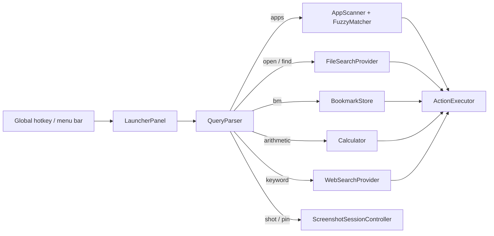

<div align="center">

# 🎩 Pennyworth

**A native, lightweight, keyboard-first launcher for macOS**

Apps · Files & bookmarks · Calculator · Clipboard history · Screenshots & pins · Image upload · Smooth mouse scrolling

[](#installation)
[](https://swift.org)
[](https://developer.apple.com/documentation/appkit)
[](Package.swift)
[](LICENSE)

[简体中文](README.md) · **English**

</div>

---

Pennyworth is a menu bar utility inspired by Alfred and built from scratch in Swift + AppKit. Press **F19** to open the search bar and launch apps, find files, open bookmarks, search the web, or calculate — all from one place. It also bundles clipboard history, region screenshots with annotation and pinning, multi-cloud image upload, and smooth mouse scrolling, so you don't need a pile of separate apps.

> [!NOTE]
> Pennyworth is an independent implementation. It contains no Alfred code or assets and does not aim for compatibility with Alfred features or Workflows.

## Contents

- [Features](#features)
- [Installation](#installation)
- [Quick Start](#quick-start)
- [Feature Guide](#feature-guide)
- [Permissions](#permissions)
- [Privacy & Data](#privacy--data)
- [Development](#development)
- [Project Structure](#project-structure)
- [Roadmap](#roadmap)
- [Contributing](#contributing)
- [Acknowledgements](#acknowledgements)
- [License](#license)

## Features

| | Feature | In one line |
|---|---|---|
| 🚀 | **App launcher** | Fuzzy matching with abbreviations (`sfr` → Safari) and localized app names, ranked by usage |
| 📁 | **File search** | Spotlight-backed; `open` to open, `find` to reveal in Finder; only the folders you choose |
| 🔖 | **Chrome bookmarks** | Import bookmarks from multiple Chrome profiles; search with `bm` or mixed into regular results |
| 🌐 | **Web search** | Built-in Google, Bing, DuckDuckGo, Wikipedia, YouTube and more, plus custom URL templates |
| 🧮 | **Calculator** | Exact decimal arithmetic; press Return to copy the result |
| 📋 | **Clipboard history** | Text, images and files with thumbnails and a large preview; open with ⌥⌘C |
| 📸 | **Screenshots & pins** | Region / window capture; rectangle, ellipse, arrow, pen, text and mosaic; pin to the desktop |
| ☁️ | **Image upload** | uPic-style uploads to S3-compatible storage, Aliyun OSS, Tencent COS and Qiniu; link copied automatically |
| ⌨️ | **Global hotkeys** | Bind hotkeys to any app; **left ⌘ and right ⌘ are separate keys**; use a lone right-⌘ tap, a modifier double-tap or a bare F19 as a hotkey |
| 🖱️ | **Mouse tweaks** | Reverse wheel direction for mice only (trackpad untouched) and smooth inertial scrolling |

**Design principles**

- **Native, zero dependencies** — only Apple frameworks (AppKit, ScreenCaptureKit, CryptoKit, Security, …). No Electron, no third-party runtime libraries.
- **Local first** — search, clipboard and bookmarks stay on your Mac. The network is used only when you run a web search or upload a file.
- **Lives in the menu bar** — runs as `LSUIElement`, with no Dock icon.
- **Bilingual UI** — Simplified Chinese and English, switchable in Settings.
- **Tested** — 400+ unit tests cover the core modules. Tests use isolated temp directories, UserDefaults and pasteboards, so they never touch your real environment.

## Installation

> [!IMPORTANT]
> There is no signed and notarized release yet, so you need to build from source. Only the Xcode command line tools are required — no Xcode project to open.

**Requirements**

- macOS 13 Ventura or later
- Xcode 15+ or matching Command Line Tools (Swift 5.9+)

**Build and run**

```bash
git clone https://github.com/clearmann/pennyworth.git
cd pennyworth
make run          # build Release, bundle Pennyworth.app and show the search bar
```

The app bundle is written to `Pennyworth.app` in the repository root. Drag it into `/Applications` to keep it.

<details>
<summary><b>About code signing (permissions lost after a rebuild? read this)</b></summary>

<br>

`build.sh` uses ad-hoc signing by default (`CODE_SIGN_IDENTITY=-`). An ad-hoc signature changes on every rebuild, so macOS treats the result as a new app and previously granted permissions such as Screen Recording and Accessibility stop applying.

If you rebuild often, create a self-signed code signing certificate in Keychain Access and pass it at build time:

```bash
CODE_SIGN_IDENTITY="Your certificate name or SHA-1" ./build.sh
```

When an identity is set explicitly, a signing failure aborts the build instead of silently falling back to ad-hoc.

You can also build into an isolated location without overwriting the default `Pennyworth.app`:

```bash
APP_BUNDLE=.build/signing-check/Pennyworth.app ./build.sh
```

`APP_BUNDLE` must end in `.app`, and relative paths resolve from the repository root. If the target already exists, it must be a non-symlinked bundle with `CFBundleIdentifier=com.clearmann.pennyworth`; otherwise the script refuses to overwrite it.

</details>

## Quick Start

1. After launch, the Pennyworth icon appears in the menu bar.
2. Click the menu bar icon → Settings. Under General → Global Hotkeys, click the recorder and press **F19** to make it the search hotkey.
3. Press **F19**, type `sfr`, and press Return to open Safari.
4. Type `23*17` and press Return to copy `391` to the clipboard.
5. Press **⌥⌘C** for clipboard history, or **⌃⌥P** to take a screenshot.

**Common hotkeys**

| Hotkey | Action | Notes |
|---|---|---|
| `F19` | Show / hide the search bar | Recommended. The out-of-the-box default is `⌥Space` (falling back to `⌥⇧Space`, then `⌃⌥Space`; the menu bar shows the active one) — record F19 under Settings → General |
| `⌥⌘C` | Clipboard history | Configurable |
| `⌃⌥P` | Region screenshot | Configurable or can be disabled |
| Unset | Upload clipboard / upload file | Record them on the Image Upload page |

When a hotkey fails to register you get an explicit message — Pennyworth never silently swaps in another combination. Even if no hotkey works, Settings remains reachable from the menu bar.

> [!TIP]
> **No F19 key?** Most Mac keyboards don't have one. We recommend using [Karabiner-Elements](https://karabiner-elements.pqrs.org/) to turn right ⌘ into "F19 when tapped, Hyper when held" — then a quick tap of right ⌘ opens the search bar. See [App shortcuts & hotkey recording](#️-app-shortcuts--hotkey-recording) for the rule. Without Karabiner, you can also just tap right ⌘ alone in the recorder.

**Launcher commands**

| Input | Behavior |
|---|---|
| `Safari`, `sfr`, `微信` | Fuzzy-search apps; Return launches |
| `github` | Matches apps and imported bookmarks (apps first) |
| `bm github` | Bookmarks only; `bm` alone lists up to 50 items |
| `open report`, ` report` (leading space), `'report` | Search file names; Return opens |
| `find report` | Search file names; Return reveals in Finder |
| `23*17`, `= (12+3)*4` | Calculate; Return copies the result |
| `google …`, `bing …`, `ddg …` | Search with a specific engine |
| `wiki …`, `youtube …`, `maps …`, `translate …` | Other built-in web searches |
| `gh Swift` (custom) | Search with your own URL template |
| `shot`, `screenshot`, `截图` | Start a region screenshot |
| `pin`, `贴图` | Pin the clipboard image to the desktop |
| Last row for any text | Search with the default engine (can be limited to when there are no local results) |
| `↑` `↓` / `Return` / `Esc` | Select / run / close |

## Feature Guide

### 🚀 Launcher & app search

- Matches are scored in tiers — exact > prefix > word start > word initials > substring > subsequence — and a weaker tier never outranks a stronger one. Abbreviations like `sfr` and `vsc` still find their targets.
- Localized app names are supported: on a Chinese system you can search for 「微信」 or 「访达」 directly.
- With "Remember application usage frequency" enabled, apps launched through Pennyworth move up by frequency. Frequency only reorders matches within the same tier, and the history can be cleared at any time.
- An empty query shows no results — just a clean search bar.
- The panel opens on the current screen across multiple displays, Spaces and full-screen apps. Closing with `Esc` returns focus to the previous app.

### 📁 File search

**Add folders first under Settings → File Search** (Documents, Desktop and Downloads are good choices). Without configured folders, no system-wide query is issued.

- Searches file names that **Spotlight has indexed** in the selected folders. File contents are not searched.
- `open` / leading space / `'` prefix opens with the default app; `find` reveals and highlights the file in Finder.
- Protected folders, external volumes and unindexed folders may return nothing — that does not indicate a permission problem.

### 🧮 Calculator

- Supports decimals, parentheses, unary plus/minus and `+ - * /`, computed with `Decimal` so `0.1 + 0.2` has no binary floating-point error.
- Input that looks like arithmetic is evaluated automatically; a leading `=` forces calculator mode.
- Return copies the result — the clipboard is written only at that point.
- Limits: up to 512 characters and 32 levels of nested parentheses. Division by zero, overflow and similar cases produce clear error messages. Powers, percentages, scientific functions and scientific notation are not supported yet.

### 🌐 Web search

Under Settings → Web Search you can enable or disable built-in engines and add custom ones:

```text
Keyword:      gh
Display name: GitHub
Search URL:   https://github.com/search?q={query}
```

Then type `gh Swift` and press Return to open GitHub search in your default browser.

- Queries are URL-encoded, so spaces, CJK text, `+`, `&` and `#` never break the template.
- Only HTTP / HTTPS URLs without credentials are accepted; up to 64 custom searches.
- Keywords must be unique and cannot use reserved commands: `bm`, `open`, `find`, `shot`, `screenshot`, `截图`, `pin`, `贴图`.
- The browser opens only when you run a result; typing never sends network requests.

### 🔖 Chrome bookmarks

1. Open Settings → Web Bookmarks and enable "Search Chrome bookmarks".
2. Click "Detect Profiles", or pick a Chrome data folder containing `Default` / `Profile …` subfolders.
3. Select the profiles you want and click "Import / Refresh Now".
4. Search with `bm keyword`, or see bookmark results in regular searches.

<details>
<summary>More details</summary>

<br>

- Reads the plain-text `Bookmarks` and `AccountBookmarks` files in each profile, keeping titles, folder paths and source information. Encrypted storage is not supported and the UI says so.
- Bookmarks are imported only when you refresh manually — no background sync, and Chrome is not scanned at launch. Chrome does not need to be closed; if it happens to be writing the file, the last successful snapshot is kept and you can retry later.
- Only HTTP / HTTPS URLs without credentials are imported and opened. Duplicate URLs are merged while preserving query strings and fragments.
- "Clear Imported Bookmarks…" deletes only Pennyworth's local snapshot. It never modifies Chrome or your profile selection.
- Format references: [Chromium bookmark codec](https://chromium.googlesource.com/chromium/src/+/main/components/bookmarks/browser/bookmark_codec.cc), [file name constants](https://chromium.googlesource.com/chromium/src/+/main/components/bookmarks/common/bookmark_constants.cc).

</details>

### 📋 Clipboard history

Press **⌥⌘C** to open the dedicated clipboard history panel.

- Records recently copied **text, images and files** in the background, with keyword filtering.
- Image entries show thumbnails, and the selected image appears as a proportional preview on the right.
- `↑` `↓` to select, `Return` to restore to the system clipboard, `Esc` to close.
- Capacity: up to 200 entries, of which at most 20 images; entries older than 30 days are pruned automatically.

### 📸 Screenshots, annotation & pins

Press **⌃⌥P**, or type `shot` / `截图` in the launcher.

- **Selection**: drag to select any region, or hover over a window to snap to it; works across multiple displays.
- **Annotation**: rectangle, ellipse, arrow, pen, text and mosaic, with undo / redo.
- **Output**: copy to the clipboard, save as PNG, or **pin** it as an always-on-top floating window. `Return` confirms, `Esc` cancels.
- **Pinned windows**: drag to move, scroll to zoom, double-click or `Esc` to close; up to 20 at once. Type `pin` / `贴图` to pin the image currently on the clipboard.
- Uses ScreenCaptureKit on macOS 14+, falling back to CoreGraphics on macOS 13.

### ☁️ Image upload

Modeled after [uPic](https://github.com/gee1k/uPic): upload an image or file and the link is copied to the clipboard.

| Provider | Notes |
|---|---|
| S3-compatible | AWS S3, Cloudflare R2, MinIO, …; optional path-style addressing |
| Aliyun OSS | |
| Tencent COS | |
| Qiniu Kodo | Region selection supported |

- **Ways to upload**: hotkeys for the clipboard or a chosen file, or **drop files onto the menu bar icon**.
- **Link formats**: URL, Markdown, HTML and UBB; switch host and format quickly from the menu bar.
- **Save path template**: defaults to `uPic/{year}/{month}/{filename}{.suffix}`. Variables: `{year}` `{month}` `{day}` `{hour}` `{minute}` `{second}` `{since_second}` `{since_millisecond}` `{random}` `{filename}` `{.suffix}` `{suffix}`.
- **Compression**: optionally compress images to 10%–100% quality before upload; 100% keeps the original.
- **Security**: Secret Keys live only in the macOS Keychain and are never written to settings in plain text. Request signing is implemented with CryptoKit — no SDKs.
- **Limits**: 100 MB per file, up to 32 hosts, and the 100 most recent uploads kept in history.

### ⌨️ App shortcuts & hotkey recording

- Under Settings → App Shortcuts, bind a global hotkey to any app to launch it or switch to it.
- Every hotkey is checked for conflicts. Registration failures are reported in a dialog with a shortcut to Settings.

**Left ⌘ and right ⌘ are different keys**

macOS treats both ⌘ keys as one modifier. Pennyworth tells them apart:

| Key | Role in Pennyworth |
|---|---|
| Left ⌘ | Keeps its system behavior — `⌘W`, `⌘Q`, `⌘C` and friends are untouched |
| Right ⌘ + key | Reserved for app shortcuts. Bind WeChat to "right ⌘W" and "left ⌘W" still closes windows |
| Right ⌘ tapped alone | A standalone hotkey — effectively an extra F19 key, e.g. to open the search bar |

- Pennyworth only takes over a combination while right ⌘ is held; unbound "right ⌘ + key" combinations go to the system as usual.
- Holding right ⌘ or using it in a combination is never mistaken for a tap.

**F19 (and F13–F20) support**

- F13–F20 work as hotkeys **with no modifier at all** — F19 is the most popular choice. Other plain keys require a modifier.
- The recorder accepts four kinds of input: regular combinations, bare F13–F20, **modifier double-taps** (⌘ / ⌥ / ⌃ / ⇧), and a **lone right-⌘ tap**.

**Recommended setup: tap right ⌘ = F19, hold = Hyper**

Add this rule to `complex_modifications.rules` in [Karabiner-Elements](https://karabiner-elements.pqrs.org/):

```json
{
  "description": "Right ⌘ → Hyper (⌘⌃⌥⇧); tap alone → F19",
  "manipulators": [
    {
      "type": "basic",
      "from": { "key_code": "right_command", "modifiers": { "optional": ["any"] } },
      "to": [{ "key_code": "left_shift", "modifiers": ["left_command", "left_control", "left_option"] }],
      "to_if_alone": [{ "key_code": "f19" }]
    }
  ]
}
```

With it in place:

- **Tapping right ⌘ sends F19**: record F19 as the search hotkey under Settings → General, and a single tap of right ⌘ shows / hides the search bar.
- **Holding right ⌘ presses ⌘⌃⌥⇧ at once**: record app shortcuts as Hyper combinations (e.g. `⌃⌥⇧⌘W`), which almost never clash with shortcuts built into other apps.
- **Left ⌘ is untouched** — `⌘W`, `⌘Q`, `⌘C` work as always.

> [!NOTE]
> After this rule the system only sees left-side modifiers, so Pennyworth can no longer detect "right ⌘ + key" or a lone right-⌘ tap. Pick one approach: with Karabiner, use F19 + Hyper; without it, use Pennyworth's native right-⌘ detection.

### 🖱️ Mouse tweaks

- **Independent wheel reversal**: affects physical mice only; the trackpad keeps natural scrolling.
- **Smooth scrolling**: turns notched wheel steps into smooth inertial scrolling, with Crisp / Balanced / Silky curves and a speed multiplier from 0.5x to 3.0x.
- ⌘ / ⌃ + wheel zooming and trackpad gestures are unaffected.

## Permissions

Pennyworth asks for these only when you use the related feature:

| Permission | Purpose | When |
|---|---|---|
| Screen Recording | Capture screen content and detect windows | Screenshots / pins |
| Accessibility | Intercept and rewrite mouse wheel events | Wheel reversal or smooth scrolling |
| Keychain | Store image host Secret Keys | Configuring an image host |

> [!TIP]
> If permissions seem to "disappear" after a rebuild, the ad-hoc signature probably changed — see [About code signing](#installation).

## Privacy & Data

- **No data collection** — no analytics, telemetry or update checks.
- Network access happens only when you run a web search (opened in your browser) or upload a file to a host you configured.
- Local data lives in `~/Library/Application Support/Pennyworth/`:

| File | Contents |
|---|---|
| `clipboard.json` | Clipboard history |
| `bookmarks.json` | Imported Chrome bookmark snapshot |
| `upload-history.json` | Upload history (with thumbnails) |

Settings are stored in `UserDefaults` (`com.clearmann.pennyworth`) and secrets in the Keychain. Delete that folder and the preferences to remove all Pennyworth data.

## Development

```bash
make build       # Debug build
make test        # Run all tests
make coverage    # Run tests with coverage
make app         # Release build and bundle Pennyworth.app
make run         # Bundle, launch and show the search bar
make clean       # Remove build artifacts
```

Plain SwiftPM works too: `swift build`, `swift test`. The package uses `swift-tools-version:5.9` and has no Xcode project, so any SwiftPM-capable editor will do.

Tests use temp directories, isolated `UserDefaults` and uniquely named pasteboards. They never clear your real clipboard or change existing settings.

<details>
<summary><b>Manual acceptance checklist</b> (GUI and permission flows that can't be automated)</summary>

<br>

- [ ] The menu bar and the active hotkey both open the search bar; `Esc` and clicking outside close it.
- [ ] `sfr` finds Safari and `Return` runs it exactly once; confirming a Chinese IME candidate does not launch anything.
- [ ] After adding an indexed folder in Settings, `open` and `find` return and act on results.
- [ ] `23*17` shows `391` and `Return` copies it; `=1/0` shows an error.
- [ ] `ddg 中文 & notes` opens the correct URL only when run.
- [ ] A custom `gh` search survives a restart; disabling a built-in returns its keyword to regular search.
- [ ] Settings persist across restarts; a hotkey conflict never loses a working hotkey.
- [ ] Window placement and focus behave correctly with multiple displays, Spaces and full-screen apps.
- [ ] Clipboard history and the launcher hotkeys don't interfere; text, images and files filter and restore, and the image preview follows the selection.
- [ ] Imported Chrome bookmarks appear in regular search and `bm`; deselecting a source removes them; a failed refresh keeps the old bookmarks searchable.
- [ ] Screenshots select regions and windows; annotate, copy, save and pin all work; pins can be moved, zoomed and closed.
- [ ] With a host configured, uploading a clipboard image and a file dropped on the menu bar copies the link in the chosen format.
- [ ] Wheel reversal and smooth scrolling work while trackpad behavior stays the same.

</details>

## Project Structure

```text
Sources/Pennyworth/
├── Launcher/        # Launcher state model and action execution
├── Search/          # Query parsing and search request models
├── Applications/    # App scanning and localized names
├── Files/           # NSMetadataQuery-based file search
├── Bookmarks/       # Chrome bookmark import and snapshots
├── WebSearch/       # Built-in and custom web searches
├── Calculator/      # Decimal expression parsing and evaluation
├── Clipboard/       # Clipboard monitoring, storage and history panel
├── Screenshots/     # Capture, selection, annotation editor and pinned windows
├── ImageUpload/     # Provider uploaders, signing, history and menu bar drop
├── AppShortcuts/    # App hotkey bindings and launching
├── Mouse/           # Wheel event tap and smooth scroll animation
├── Settings/        # Settings storage and native card-style settings window
├── Localization/    # Localization support
├── UI/              # Floating panel components and theme
└── Resources/       # en / zh-Hans localized resources
```



## Roadmap

The current version, `0.1.0`, is early. The following are **not included yet** — discussion welcome:

- [ ] Signed, notarized releases and auto-update
- [ ] Launch at login
- [ ] Snippets
- [ ] Workflows / plugins
- [ ] Full-text file search
- [ ] Theme import

## Contributing

Issues and pull requests are welcome. Before submitting:

1. Run `make test` and make sure everything passes; include tests with new features.
2. Keep zero third-party dependencies — system frameworks only.
3. Update both `en.lproj` and `zh-Hans.lproj` under `Sources/Pennyworth/Resources/` for any new UI text.
4. Follow [Conventional Commits](https://www.conventionalcommits.org/), e.g. `feat: …`, `fix: …`.

## Acknowledgements

- [Alfred](https://www.alfredapp.com/) — inspiration for the launcher experience
- [uPic](https://github.com/gee1k/uPic) — reference for the upload experience and path templates

## License

[MIT](LICENSE) © 2026 clearmann
