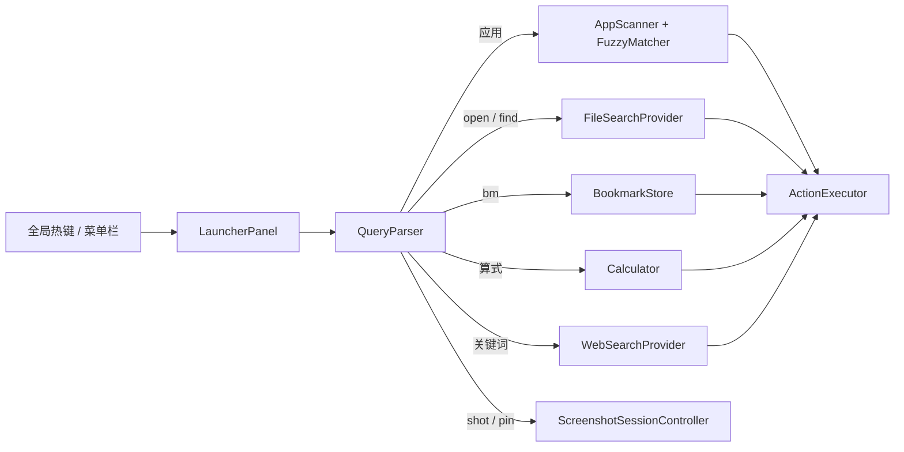

<div align="center">

# 🎩 Pennyworth

**一个原生、轻量、键盘优先的 macOS 效率启动器**

启动应用 · 搜索文件与书签 · 计算 · 剪贴板历史 · 截图标注贴图 · 图床上传 · 鼠标平滑滚动

[](#安装)
[](https://swift.org)
[](https://developer.apple.com/documentation/appkit)
[](Package.swift)
[](LICENSE)

**简体中文** · [English](README.en.md)

---

Pennyworth 是一个受 Alfred 启发、用 Swift + AppKit 从零实现的菜单栏工具。按下 **F19** 唤出搜索框，在一个入口里完成启动应用、查找文件、打开书签、网页搜索和计算；同时内置剪贴板历史、区域截图与贴图、多云图床上传和鼠标平滑滚动等常用小工具，免去安装一堆独立 App。

> [!NOTE]
> Pennyworth 是独立实现，不包含 Alfred 的任何代码或资源，也不追求与 Alfred 的功能或 Workflow 兼容。

## 目录

- [特性](#特性)
- [安装](#安装)
- [快速上手](#快速上手)
- [功能详解](#功能详解)
- [权限说明](#权限说明)
- [隐私与数据](#隐私与数据)
- [开发](#开发)
- [项目结构](#项目结构)
- [路线图](#路线图)
- [参与贡献](#参与贡献)
- [致谢](#致谢)
- [License](#license)

## 特性

| | 功能 | 一句话说明 |
|---|---|---|
| 🚀 | **应用启动** | 模糊匹配应用名，支持缩写输入（如 `sfr` → Safari）和中文本地化名称，按使用频次排序 |
| 📁 | **文件搜索** | 基于 Spotlight 索引，`open` 打开、`find` 在 Finder 中显示，仅搜索你指定的目录 |
| 🔖 | **Chrome 书签** | 手动导入多个 Chrome 个人资料的书签，`bm` 专搜或混入普通结果 |
| 🌐 | **网页搜索** | 内置 Google、Bing、DuckDuckGo、Wikipedia、YouTube 等，可自定义 URL 模板关键词 |
| 🧮 | **计算器** | 高精度十进制四则运算，回车复制结果 |
| 📋 | **剪贴板历史** | 记录文本、图片、文件，带缩略图与大图预览，⌥⌘C 唤出 |
| 📸 | **截图与贴图** | 区域 / 窗口截图，矩形、椭圆、箭头、画笔、文字、马赛克标注，一键贴图到桌面 |
| ☁️ | **图床上传** | uPic 风格，支持 S3 兼容存储、阿里云 OSS、腾讯云 COS、七牛云，自动复制链接 |
| ⌨️ | **全局快捷键** | 为任意应用绑定快捷键；**左 ⌘ 与右 ⌘ 是两个独立的键**，可单独轻按右 ⌘、双击修饰键或裸按 F19 作为热键 |
| 🖱️ | **鼠标增强** | 独立反转鼠标滚轮方向（不影响触控板），为普通鼠标提供平滑惯性滚动 |

**设计原则**

- **纯原生，零依赖** —— 只使用 Apple 系统框架（AppKit、ScreenCaptureKit、CryptoKit、Security 等），没有 Electron，也没有第三方运行时库。
- **本地优先** —— 搜索、剪贴板、书签都在本机完成；只有你执行网页搜索或上传图片时才会联网。
- **常驻菜单栏** —— 以 `LSUIElement` 运行，没有 Dock 图标，不打扰工作区。
- **双语界面** —— 内置简体中文与英文，可在设置中切换。
- **可验证** —— 核心模块有 400+ 个单元测试覆盖，测试使用独立的临时目录、UserDefaults 和 pasteboard，不会污染真实环境。

## 安装

> [!IMPORTANT]
> 目前尚未提供签名公证的发行包，需要从源码构建。构建只需要 Xcode 命令行工具，不需要打开 Xcode 工程。

**环境要求**

- macOS 13 Ventura 或更高版本
- Xcode 15+ 或对应的 Command Line Tools（Swift 5.9+）

**构建并启动**

```bash
git clone https://github.com/clearmann/pennyworth.git
cd pennyworth
make run          # 构建 Release、打包 Pennyworth.app 并立即显示搜索框
```

构建产物位于仓库根目录的 `Pennyworth.app`，可以拖到 `/Applications` 中使用。

<details>
<summary><b>关于代码签名（重编译后权限丢失？看这里）</b></summary>

<br>

`build.sh` 默认使用 ad-hoc 签名（`CODE_SIGN_IDENTITY=-`）。ad-hoc 签名在每次重新编译后都会变化，macOS 会把它视为一个新应用，导致之前授予的「屏幕录制」「辅助功能」等权限失效。

如果你需要频繁重编译，建议在钥匙串中创建一张自签名代码签名证书，并在构建时指定：

```bash
CODE_SIGN_IDENTITY="你的证书名称或 SHA-1" ./build.sh
```

显式指定 identity 后，签名失败会直接终止构建，不会悄悄降级为 ad-hoc。

还可以输出到隔离目录，不覆盖默认的 `Pennyworth.app`：

```bash
APP_BUNDLE=.build/signing-check/Pennyworth.app ./build.sh
```

`APP_BUNDLE` 必须以 `.app` 结尾，相对路径以仓库根目录为基准；如果目标已存在，它必须是 `CFBundleIdentifier=com.clearmann.pennyworth` 的非符号链接 bundle，否则脚本拒绝覆盖。

</details>

## 快速上手

1. 启动后，菜单栏会出现 Pennyworth 图标。
2. 点击菜单栏图标 →「设置」，在「通用 → 全局热键」中点击录制框，按一下 **F19**，把它设为搜索热键。
3. 按 **F19** 唤出搜索框，输入 `sfr`，回车打开 Safari。
4. 输入 `23*17`，回车把 `391` 复制到剪贴板。
5. 按 **⌥⌘C** 打开剪贴板历史，按 **⌃⌥P** 开始截图。

**常用快捷键**

| 快捷键 | 动作 | 说明 |
|---|---|---|
| `F19` | 唤出 / 隐藏搜索框 | 推荐设置。首次启动默认是 `⌥Space`（被占用时依次尝试 `⌥⇧Space`、`⌃⌥Space`，菜单栏会标明实际生效的组合），在「设置 → 通用」中录制 F19 即可 |
| `⌥⌘C` | 剪贴板历史 | 可在设置中修改 |
| `⌃⌥P` | 区域截图 | 可修改或禁用 |
| 未设置 | 上传剪贴板 / 上传文件 | 在「图床上传」页按需录制 |

快捷键注册失败时会明确提示，不会静默换成其他组合。所有快捷键都不可用时，仍可通过菜单栏进入设置。

> [!TIP]
> **键盘上没有 F19？** 大多数 Mac 键盘确实没有。推荐用 [Karabiner-Elements](https://karabiner-elements.pqrs.org/) 把右 ⌘ 改成「单击发送 F19、按住作为 Hyper 键」，之后轻点右 ⌘ 就能唤出搜索框，规则见 [应用快捷键与热键录制](#️-应用快捷键与热键录制)。不想装 Karabiner 的话，也可以直接在录制框里单独轻按右 ⌘。

**启动器命令速查**

| 输入 | 行为 |
|---|---|
| `Safari`、`sfr`、`微信` | 模糊搜索应用，回车启动 |
| `github` | 同时匹配应用和已导入的书签（应用优先） |
| `bm github` | 仅搜索书签；只输入 `bm` 时最多列出 50 项 |
| `open 报告`、` 报告`（前导空格）、`'报告` | 按文件名搜索，回车打开 |
| `find 报告` | 按文件名搜索，回车在 Finder 中显示 |
| `23*17`、`= (12+3)*4` | 计算，回车复制结果 |
| `google 关键词`、`bing …`、`ddg …` | 用指定搜索引擎搜索 |
| `wiki …`、`youtube …`、`maps …`、`translate …` | 其他内置网页搜索 |
| `gh Swift`（自定义） | 使用你配置的 URL 模板搜索 |
| `shot`、`screenshot`、`截图` | 开始区域截图 |
| `pin`、`贴图` | 把剪贴板中的图片贴到桌面 |
| 任意文本的最后一项 | 用默认搜索引擎搜索（可设为仅在无本地结果时显示） |
| `↑` `↓` / `Return` / `Esc` | 选择 / 执行 / 关闭 |

## 功能详解

### 🚀 启动器与应用搜索

- 模糊匹配按「完全匹配 > 前缀 > 单词开头 > 单词首字母 > 子串 > 子序列」分档打分，较弱的档位永远不会排到较强档位前面，`sfr`、`vsc` 这类缩写也能命中目标。
- 支持应用的本地化名称：在中文系统下可以直接搜索「微信」「访达」。
- 开启「记住应用使用频率」后，经 Pennyworth 成功启动过的应用会按频次靠前；频次只在同档匹配之间调整顺序，记录可随时清空。
- 空输入时不显示任何结果，只保留一个干净的搜索框。
- 多显示器、Spaces 和全屏应用下都会在当前屏幕弹出；按 `Esc` 关闭时会把焦点还给之前的应用。

### 📁 文件搜索

**需要先在「设置 → 文件搜索」中添加目录**（建议添加文稿、桌面、下载）。未配置目录时不会发起全盘查询。

- 仅搜索所选目录中 **Spotlight 已建立索引** 的文件名，不搜索文件内容。
- `open` / 前导空格 / `'` 前缀：用默认应用打开；`find` 前缀：在 Finder 中定位并高亮。
- 受保护目录、外置卷和未建立索引的目录可能没有结果，这并不代表权限异常。

### 🧮 计算器

- 支持十进制小数、括号、一元正负号以及 `+ - * /`，基于 `Decimal` 运算，避免 `0.1 + 0.2` 这类二进制浮点误差。
- 输入看起来像算式时自动进入计算；以 `=` 开头可以强制进入计算模式。
- 回车复制结果，只有这时才会写入剪贴板。
- 边界：输入最长 512 字符，括号嵌套最多 32 层；除零、溢出等情况会给出明确的错误提示。暂不支持幂、百分比、科学函数和科学计数法。

### 🌐 网页搜索

在「设置 → 网页搜索」中可以启用或停用内置搜索，也可以新增自定义搜索：

```text
关键词：  gh
显示名称：GitHub
搜索 URL：https://github.com/search?q={query}
```

之后输入 `gh Swift` 并回车，就会在默认浏览器中打开 GitHub 搜索结果。

- 查询内容按 URL 规则编码，空格、中文、`+`、`&`、`#` 都不会破坏模板。
- 只接受不含账号密码的 HTTP / HTTPS 地址；最多保存 64 个自定义搜索。
- 关键词不能重复，也不能占用保留命令：`bm`、`open`、`find`、`shot`、`screenshot`、`截图`、`pin`、`贴图`。
- 只有在执行结果时才会打开浏览器，输入过程中不会发出任何网络请求。

### 🔖 Chrome 书签

1. 打开「设置 → 网页书签」，启用「搜索 Chrome 书签」。
2. 点击「检测个人资料」，或手动选择包含 `Default` / `Profile …` 子目录的 Chrome 数据目录。
3. 勾选需要的个人资料，点击「立即导入 / 刷新」。
4. 用 `bm 关键词` 搜索，或者直接在普通搜索中查看书签结果。

<details>
<summary>更多细节</summary>

<br>

- 支持每个个人资料中的明文 `Bookmarks` 和 `AccountBookmarks`，保留标题、文件夹路径和来源信息；加密存储暂不支持，界面会给出提示。
- 书签只在你手动刷新时导入，没有后台同步，启动时也不会扫描 Chrome。导入不需要退出 Chrome；如果恰好遇到 Chrome 正在写入，会保留上次成功的快照，稍后重试即可。
- 只导入和打开不含账号密码的 HTTP / HTTPS 网址；相同网址合并展示，保留查询参数和片段。
- 「清除已导入书签」只删除 Pennyworth 的本地快照，不会修改 Chrome，也不会清除来源选择。
- 文件格式参考：[Chromium bookmark codec](https://chromium.googlesource.com/chromium/src/+/main/components/bookmarks/browser/bookmark_codec.cc)、[文件名定义](https://chromium.googlesource.com/chromium/src/+/main/components/bookmarks/common/bookmark_constants.cc)。

</details>

### 📋 剪贴板历史

按 **⌥⌘C** 打开独立的剪贴板历史面板。

- 在后台记录最近复制的 **文本、图片和文件**，支持输入关键词筛选。
- 图片记录显示缩略图，选中后在右侧显示等比例大图预览。
- `↑` `↓` 选择，`Return` 恢复到系统剪贴板，`Esc` 关闭。
- 容量：最多保留 200 条记录，其中图片最多 20 张；超过 30 天的记录会自动清理。

### 📸 截图、标注与贴图

按 **⌃⌥P**，或在启动器中输入 `shot` / `截图` 开始截图。

- **选区**：拖拽框选任意区域，或把鼠标悬停在窗口上自动识别整个窗口；支持多显示器。
- **标注**：矩形、椭圆、箭头、画笔、文字、马赛克，支持撤销 / 重做。
- **输出**：复制到剪贴板、保存为 PNG，或 **贴图**（钉在屏幕最上层的浮动窗口）。`Return` 确认，`Esc` 取消。
- **贴图窗口**：拖动移动，滚轮缩放，双击或 `Esc` 关闭；最多同时贴 20 张。输入 `pin` / `贴图` 可以把剪贴板中的图片直接贴出来。
- macOS 14+ 使用 ScreenCaptureKit 截图，macOS 13 自动回退到 CoreGraphics。

### ☁️ 图床上传

借鉴 [uPic](https://github.com/gee1k/uPic) 的体验：上传图片或文件后，链接自动复制到剪贴板。

| 服务商 | 说明 |
|---|---|
| S3 兼容存储 | AWS S3、Cloudflare R2、MinIO 等；可开启 Path-Style 路径风格 |
| 阿里云 OSS | |
| 腾讯云 COS | |
| 七牛云 Kodo | 支持选择存储区域 |

- **上传方式**：快捷键上传剪贴板内容或选择文件，也可以把文件 **直接拖到菜单栏图标** 上。
- **链接格式**：URL、Markdown、HTML、UBB，可以在菜单栏中快速切换图床和格式。
- **保存路径模板**：默认 `uPic/{year}/{month}/{filename}{.suffix}`，可用变量包括 `{year}` `{month}` `{day}` `{hour}` `{minute}` `{second}` `{since_second}` `{since_millisecond}` `{random}` `{filename}` `{.suffix}` `{suffix}`。
- **图片压缩**：上传前可按 10%–100% 的质量压缩，设为 100% 时保持原图。
- **安全**：Secret Key 只保存在 macOS 钥匙串中，不会以明文写入设置文件；签名算法基于 CryptoKit 实现，没有引入任何 SDK。
- **限制**：单个文件最大 100 MB，最多配置 32 个图床，保留最近 100 条上传历史。

### ⌨️ 应用快捷键与热键录制

- 在「设置 → 应用快捷键」中为任意应用绑定全局快捷键，一键启动或切换到该应用。
- 所有快捷键都会做冲突检测，注册失败时会弹窗说明，并提供跳转到设置的入口。

**左 ⌘ 和右 ⌘ 是两个不同的键**

macOS 默认把左右 ⌘ 当成同一个修饰键，Pennyworth 会分别识别它们：

| 按键 | 在 Pennyworth 中的角色 |
|---|---|
| 左 ⌘ | 保持系统原有行为，`⌘W`、`⌘Q`、`⌘C` 等完全不受影响 |
| 右 ⌘ + 按键 | 应用快捷键专用。例如把微信设为「右⌘W」后，按「左⌘W」仍然是关闭窗口 |
| 单独轻按右 ⌘ | 作为一个独立热键使用，效果相当于多出一个 F19 键，比如可以用来唤出搜索框 |

- 只有按住右 ⌘ 时，Pennyworth 才会接管已绑定的组合键；没有绑定的「右⌘ + 按键」照常交给系统处理。
- 长按右 ⌘ 或把它用作组合键，都不会被误判为「轻按」。

**支持 F19（以及 F13–F20）**

- F13–F20 可以 **不加任何修饰键** 单独作为热键，F19 是最常见的选择。其他普通按键必须搭配修饰键。
- 热键录制框支持四种输入：普通组合键、裸按 F13–F20、**双击修饰键**（⌘ / ⌥ / ⌃ / ⇧）、**单独轻按右 ⌘**。

**推荐配置：右 ⌘ 单击 = F19，按住 = Hyper**

在 [Karabiner-Elements](https://karabiner-elements.pqrs.org/) 的 `complex_modifications.rules` 中加入下面这条规则：

```json
{
  "description": "Right ⌘ → Hyper (⌘⌃⌥⇧); tap alone → F19",
  "manipulators": [
    {
      "type": "basic",
      "from": { "key_code": "right_command", "modifiers": { "optional": ["any"] } },
      "to": [{ "key_code": "left_shift", "modifiers": ["left_command", "left_control", "left_option"] }],
      "to_if_alone": [{ "key_code": "f19" }]
    }
  ]
}
```

配置好后：

- **轻点右 ⌘ 就是 F19**：在「设置 → 通用」把搜索热键录成 F19，单击右 ⌘ 即可唤出 / 隐藏搜索框。
- **按住右 ⌘ 等于同时按下 ⌘⌃⌥⇧**：可以把应用快捷键录成 Hyper 组合（例如 `⌃⌥⇧⌘W`），几乎不会和任何应用自带的快捷键冲突。
- **左 ⌘ 完全不受影响**，`⌘W`、`⌘Q`、`⌘C` 照常使用。

> [!NOTE]
> 经过这条规则后，系统收到的是左侧修饰键，Pennyworth 无法再识别「右⌘ + 按键」和「单独轻按右 ⌘」。这两种用法与 Karabiner 方案二选一：装了 Karabiner 就用 F19 + Hyper；不装就用 Pennyworth 原生的右 ⌘ 识别。

### 🖱️ 鼠标增强

- **独立反转滚轮方向**：只对物理鼠标生效，触控板保持「自然滚动」不变。
- **平滑滚动**：把普通鼠标滚轮离散的跳动变成带惯性的平滑滚动，提供「干脆 / 标准 / 柔和」三档手感，滚动速度可在 0.5x–3.0x 之间调节。
- 按住 ⌘ 或 ⌃ 的滚轮缩放以及触控板手势不受影响。

## 权限说明

Pennyworth 只在你使用对应功能时才需要以下权限：

| 权限 | 用途 | 何时需要 |
|---|---|---|
| 屏幕录制 | 截取屏幕内容、识别窗口 | 使用截图 / 贴图时 |
| 辅助功能 | 拦截并改写鼠标滚轮事件 | 启用鼠标反转或平滑滚动时 |
| 钥匙串 | 保存图床的 Secret Key | 配置图床时 |

> [!TIP]
> 如果重新编译后发现权限「失效」，通常是 ad-hoc 签名变化导致的，参见 [关于代码签名](#安装)。

## 隐私与数据

- **不收集任何数据**，没有统计、遥测或自动更新请求。
- 网络请求只发生在两种情况下：你执行网页搜索（由浏览器打开），以及你主动上传文件到自己配置的图床。
- 本地数据保存在 `~/Library/Application Support/Pennyworth/`：

| 文件 | 内容 |
|---|---|
| `clipboard.json` | 剪贴板历史 |
| `bookmarks.json` | 导入的 Chrome 书签快照 |
| `upload-history.json` | 上传历史（含缩略图） |

设置保存在 `UserDefaults`（`com.clearmann.pennyworth`），密钥保存在钥匙串中。删除上述目录和偏好即可完全清除 Pennyworth 的数据。

## 开发

```bash
make build       # Debug 构建
make test        # 运行全部测试
make coverage    # 运行测试并生成覆盖率
make app         # Release 构建并打包 Pennyworth.app
make run         # 打包并启动，立即显示搜索框
make clean       # 清理构建产物
```

也可以直接使用 SwiftPM：`swift build`、`swift test`。项目使用 `swift-tools-version:5.9`，不依赖 Xcode 工程文件，任何支持 SwiftPM 的编辑器都可以开发。

测试使用临时目录、独立的 `UserDefaults` 和独立命名的 pasteboard，不会清空你真实的系统剪贴板，也不会改动已有设置。

<details>
<summary><b>本机验收清单</b>（涉及 GUI 与系统权限、无法自动化的部分）</summary>

<br>

- [ ] 菜单栏和实际生效的热键都能唤出搜索框；`Esc`、点击外部可关闭。
- [ ] `sfr` 找到 Safari，`Return` 只执行一次；中文输入法确认候选词时不会误启动。
- [ ] 在设置中添加已索引目录后，`open` 和 `find` 能检索并执行。
- [ ] `23*17` 显示 `391`，`Return` 复制；`=1/0` 显示错误。
- [ ] `ddg 中文 & notes` 在执行时才打开正确的搜索地址。
- [ ] 添加 `gh` 自定义搜索，重启后仍可用；禁用内置项后对应关键词回到普通搜索。
- [ ] 设置在重启后保留；热键冲突不会丢失原有可用热键。
- [ ] 多屏、Spaces、全屏应用下窗口位置与焦点正常。
- [ ] 剪贴板历史与主搜索快捷键互不影响；文本、图片、文件都能筛选并恢复，图片预览随选择同步更新。
- [ ] 导入 Chrome 书签后普通搜索与 `bm` 都能找到；取消来源后结果消失，刷新失败时旧书签仍可搜索。
- [ ] 截图能框选区域与窗口，标注、复制、保存、贴图均正常；贴图可拖动、缩放、关闭。
- [ ] 配置图床后上传剪贴板图片与拖拽到菜单栏的文件，链接按所选格式复制。
- [ ] 鼠标滚轮反转与平滑滚动生效，触控板行为不变。

</details>

## 项目结构

```text
Sources/Pennyworth/
├── Launcher/        # 启动器状态模型与动作执行
├── Search/          # 查询解析与搜索请求模型
├── Applications/    # 应用扫描与本地化名称
├── Files/           # 基于 NSMetadataQuery 的文件搜索
├── Bookmarks/       # Chrome 书签导入与快照
├── WebSearch/       # 内置与自定义网页搜索
├── Calculator/      # Decimal 表达式解析与求值
├── Clipboard/       # 剪贴板监听、存储与历史面板
├── Screenshots/     # 截图、选区、标注编辑与贴图窗口
├── ImageUpload/     # 各云存储上传器、签名、历史与菜单栏拖拽
├── AppShortcuts/    # 应用快捷键绑定与启动
├── Mouse/           # 滚轮事件拦截与平滑滚动动画
├── Settings/        # 设置存储与原生卡片式设置窗口
├── Localization/    # 多语言支持
├── UI/              # 浮动面板组件与主题
└── Resources/       # en / zh-Hans 本地化资源
```



## 路线图

当前版本 `0.1.0` 处于早期阶段。以下内容 **暂不包含**，欢迎讨论：

- [ ] 签名公证的发行包与自动更新
- [ ] 登录时自动启动
- [ ] Snippets 文本片段
- [ ] Workflow / 插件扩展
- [ ] 文件全文搜索
- [ ] 主题导入

## 参与贡献

欢迎提交 Issue 和 Pull Request。提交前请：

1. 先运行 `make test`，确保全部测试通过；新增功能请附带测试。
2. 保持零第三方依赖，只使用系统框架。
3. 新增的界面文案需要同时更新 `Sources/Pennyworth/Resources/` 下的 `en.lproj` 与 `zh-Hans.lproj`。
4. 提交信息遵循 [Conventional Commits](https://www.conventionalcommits.org/)，例如 `feat: …`、`fix: …`。

## 致谢

- [Alfred](https://www.alfredapp.com/) —— 启动器交互的灵感来源
- [uPic](https://github.com/gee1k/uPic) —— 图床上传体验与路径模板的参考

## License

[MIT](LICENSE) © 2026 clearmann
